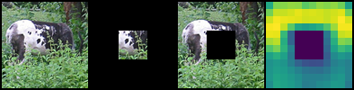
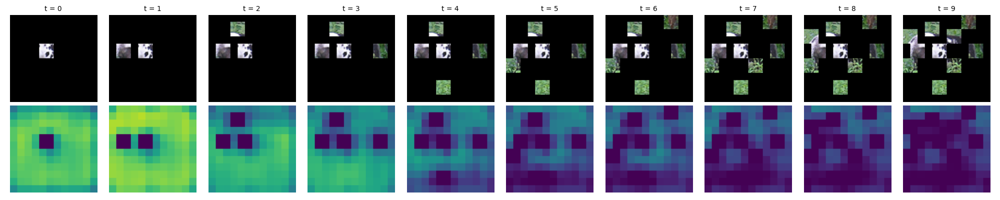
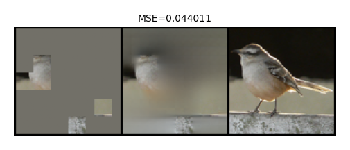
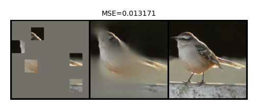

# Probabilistic Respresentation Learning for Active Vision based on Uncertainty Minimization(STL10)

## 概要
小野木(2026年卒)の修士研究であるProbabilistic I-JEPAの実装．データセットはSTL10を使用．2026年3月時点でSTL10のデータセットは以下のパスに保存．

"/home/jonoki/research/master/byol_trial/ExtreMA_stl10/data"

コードは[I-JEPAをSTL10で動かす非公式実装](https://github.com/filipbasara0/simple-ijepa?utm_source=chatgpt.com)を元に作成．

## 使い方

### 環境構築:

```bash
conda create -n p-ijepa_stl10 python=3.10 -y
conda activate p-ijepa_stl10

pip3 install torch torchvision --index-url https://download.pytorch.org/whl/cu130

pip install tqdm torchinfo einops scikit-learn matplotlib lightning timm
```

### 訓練:

コマンド：

```bash
python run_training.py
```

全ての引数をデフォルトにすると修論の結果が再現できるはず．（もちろん引数を調整することでエポックや保存先等の指定が可能）
一部パラメータはtrain.pyにベタ打ち．

以降の評価は，学習済みモデルを[](https://huggingface.co/jonoki-nitech/probabilistic_I-JEPA_STL10)からダウンロードしても実行可能．

training_model.pthは"models/embdim=512_epoch=300_patchsize=8/..."におく．

latest.ckptは"models/mae/..."におく．

### 評価1．不確実性評価：

一部ブロックを観測として与えた時の不確実性マップを出力．

出力先→"images/uncertainty/..."

コマンド：
```bash
python uncertainty_eval.py
```

実験結果例：左から元画像，観測ブロック，未観測ブロック，不確実性マップ．



### 評価2．パッチ選択:
不確実性に基づいてパッチ選択をした結果と不確実性マップの変化を出力．

出力先→"images/saccade/..."


コマンド：

```bash
python saccade_sim.py
```

実験結果例：



### 評価3．MAEを用いた再構成誤差評価

step1. パッチ選択を実行し観測パッチのインデックスをjson形式で保存(本手法とランダム選択のどちらも)

出力先→"selected_patch_index/..."

コマンド：

ファイル末尾にrandomとついているものはランダム選択，そうでないものは本手法による選択をおこなう．

```bash
python select_and_save_patch_index(_random).py
```


step2. 観測パッチのインデックスをもとに元画像をMAEで復元

出力先："images/rec_images/..."

コマンド：

```bash
python test_mae_on_selected_patches.py
```

実験結果例(ランダム)：



実験結果例(本手法)：



### 評価4．線形識別

eval_(データセット名).pyで，encoderの表現空間における各データセットの線形識別を行う．データセットはcifar10,cifar100の2つ．

コマンド：

```bash
python eval_(データセット名).py
```
